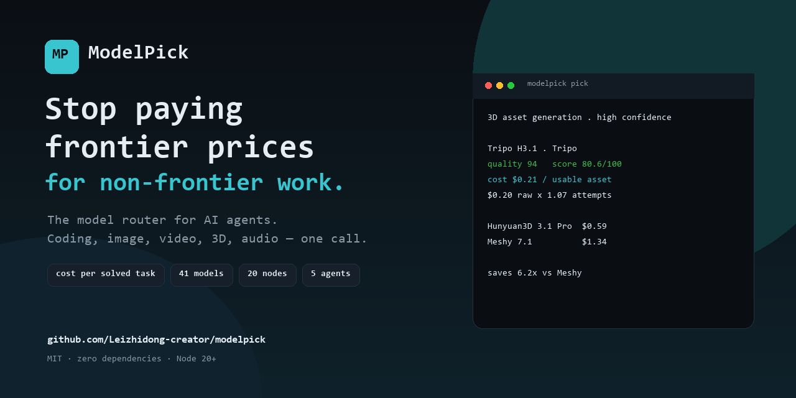
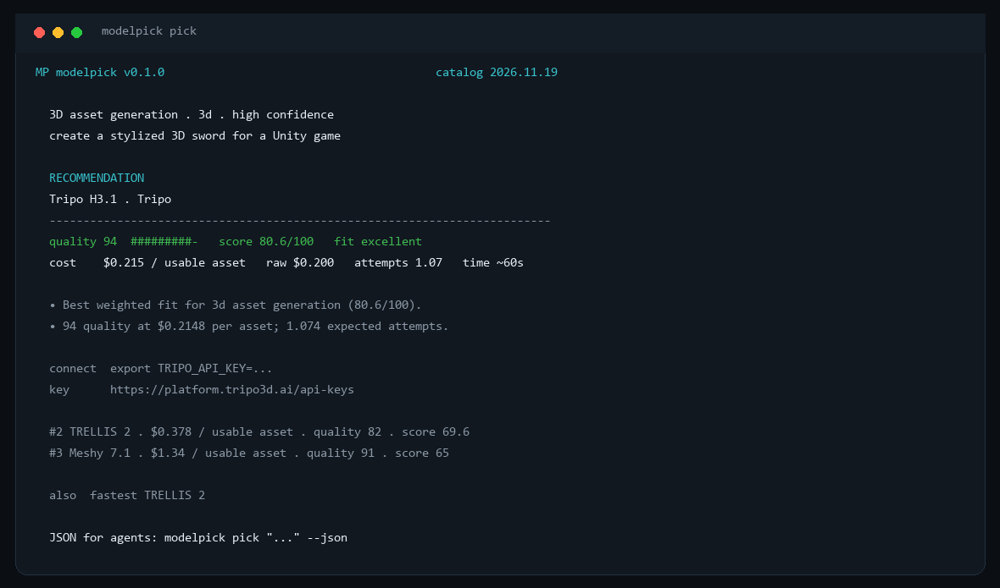
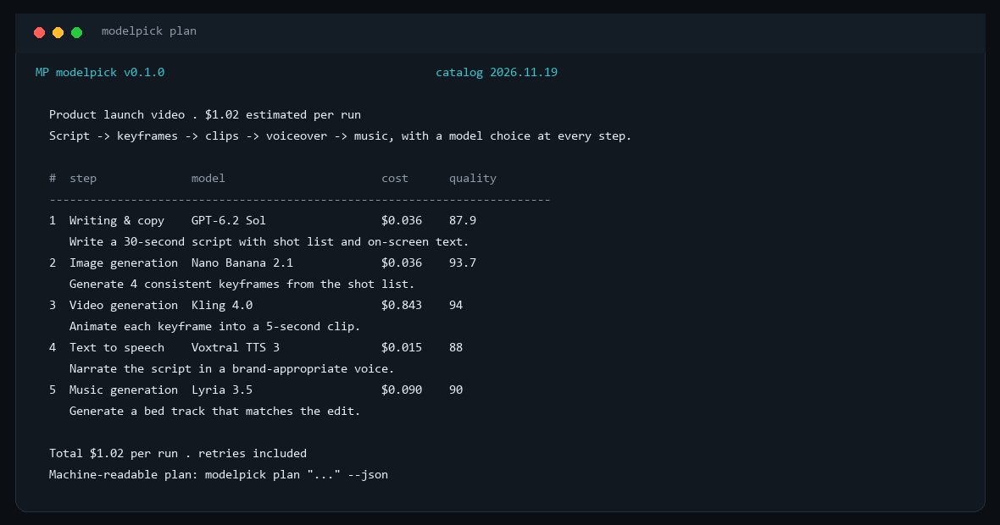
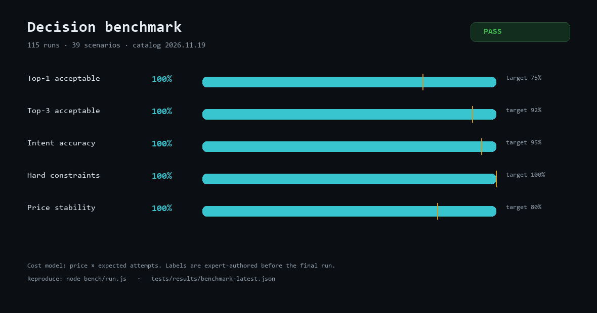
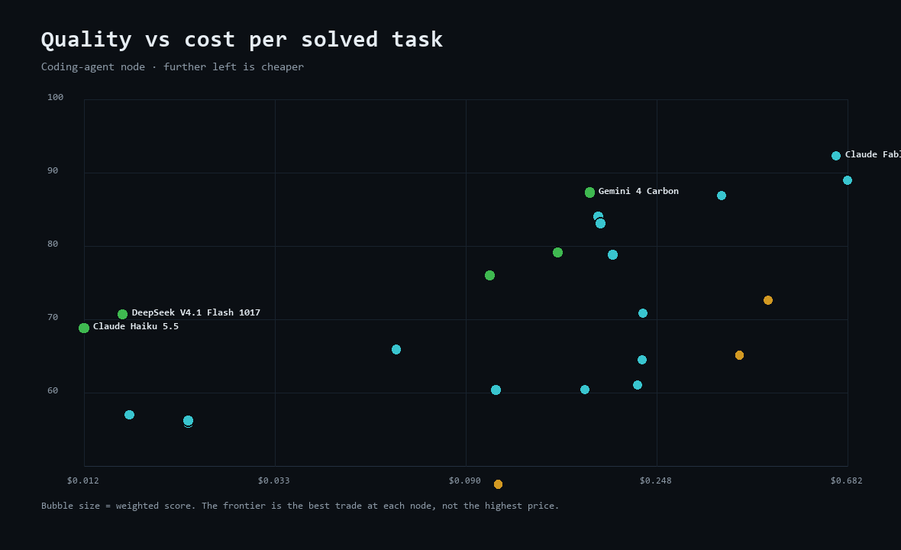

<p align="center">
  
</p>

<h1 align="center">ModelPick</h1>

<p align="center"><strong>The model router for AI agents — with cost per solved task.</strong><br/>
Coding, image, video, 3D, and audio. One CLI, one MCP server, every agent.</p>

<p align="center">
  <a href="https://github.com/Leizhidong-creator/modelpick/actions/workflows/ci.yml"></a>
  <a href="https://github.com/Leizhidong-creator/modelpick/releases"></a>
  <a href="LICENSE"></a>
  <a href="package.json"></a>
  <a href="https://modelcontextprotocol.io"></a>
  
</p>

---

Your agent can write code, call tools, and ship a feature. Then it picks **one model for everything** — a frontier model to classify a support ticket, to generate a barrel prop, to draft a thumbnail.

The result is predictable: 60–95% of the spend goes to work that did not need a frontier model, and the hard nodes still fail because the model was chosen for the wrong modality.

**ModelPick is a decision layer, not another gateway.** Before each node, it answers three questions in one call:

1. **Which model?** Ranked for this exact task, with hard capability filters (context, text-in-image, rigging, clip length, open weights).
2. **What will it really cost?** **Cost per solved task** — list price × expected attempts, not $/M tokens.
3. **How do I connect it?** The env var, key URL, docs, and API model id.

```bash
npx -y github:Leizhidong-creator/modelpick pick "create a stylized 3D sword for a Unity game"
```

<p align="center">
  
</p>

---

## Why this exists

Three things are broken in model selection today:

**1. Token prices hide the real bill.** A model that is 10× cheaper per token but needs 1.8× the attempts and 2× the output tokens is not 10× cheaper. ModelPick computes the denominator that matters: dollars per usable output.

**2. Coding agents are blind to creative nodes.** A 3D pipeline is not a text problem. Text-in-image is not image generation. A 30-second film is not a 5-second clip. ModelPick models 20 task nodes across 5 modalities, with capability filters that reject the wrong model before scoring.

**3. Every tool is a new integration.** ModelPick ships as a zero-dependency CLI, a stdio MCP server, a portable `SKILL.md`, and a Claude Code plugin. Same decision engine everywhere; no gateway, no lock-in, no key storage.

> **The wedge:** other tools route text prompts. ModelPick routes **work** — and prices it per solved task across every modality.

### How is this different from a gateway or a coding router?

| | Gateway (OpenRouter, LiteLLM, Portkey) | Coding router (claude-code-router) | **ModelPick** |
|---|---|---|---|
| Optimizes | access, failover, provider margin | model switching inside a coding loop | **cost per solved task at each node** |
| Modalities | mostly text; OpenRouter's live catalog is ~4% non-text | text | **text, image, video, 3D, audio** |
| Decision | route by price/availability | rules or a classifier | capability filters + benchmark-weighted utility |
| Keys | held by the gateway | local | **never stored; you call the provider** |
| Evidence | live prices | config | dated catalog + public benchmark + raw failures |

Gateways are useful, and ModelPick can recommend one as the setup path. But a gateway cannot tell you that a 3D node should use Tripo instead of Meshy, or that a "headline text" image needs a model with a text-rendering score above 90. That is the decision layer this project owns.

More: [`research/competitive-landscape.md`](research/competitive-landscape.md) (15 products, 10 features, 53 sources).

---

## 30-second quickstart

```bash
# 1. Ask for a recommendation (no key, no signup, no network)
npx -y github:Leizhidong-creator/modelpick pick "generate a product photo with the headline 'Fresh Roast'"

# 2. Plan a multi-step deliverable
npx -y github:Leizhidong-creator/modelpick plan "30 second product launch video"

# 3. Install into your agent (writes MCP config + skill)
npx -y github:Leizhidong-creator/modelpick setup claude-code
```

Or clone it (recommended while the npm package is pending):

```bash
git clone https://github.com/Leizhidong-creator/modelpick
cd modelpick
node bin/modelpick.js pick "refactor this 40k-line repo, cheapest that works"
node bin/modelpick.js setup
```

<p align="center">
  
</p>

---

## Works with the agents you already use

`modelpick setup` detects your tools and writes the correct files — idempotently, with backups, and without touching sibling config.

| Agent | One command | What it writes |
|---|---|---|
| **Claude Code** | `modelpick setup claude-code` | `.mcp.json`, `.claude/skills/modelpick/`, `CLAUDE.md` block |
| **OpenAI Codex CLI** | `modelpick setup codex` | `AGENTS.md`, `.agents/skills/modelpick/`, `codex mcp add` hint |
| **Cursor** | `modelpick setup cursor` | `.cursor/mcp.json`, `.cursor/rules/modelpick.mdc`, skill |
| **DeepSeek Harness** | `modelpick setup dsh` | `.dsh/skills/`, `.agents/skills/`, MCP plugin-row snippet |
| **GitHub Copilot CLI** | `modelpick setup copilot` | `.mcp.json`, `.github/skills/`, `AGENTS.md` |
| **Any MCP client** | `modelpick mcp` | stdio JSON-RPC; no keys required for recommendations |

**Claude Code plugin (one command inside Claude):**

```text
/plugin marketplace add Leizhidong-creator/modelpick
/plugin install modelpick@modelpick
```

**Platform-agnostic skill:** `.agents/skills/modelpick/SKILL.md` is read by Codex, Cursor, Copilot CLI, Devin/Windsurf, and DeepSeek Harness. Claude Code gets its own copy.

MCP tools exposed: `pick_model`, `plan_workflow`, `compare_models`, `get_setup`, `list_models`, `explain_task`.

---

## The number that matters: cost per solved task

```
raw cost per attempt = tokens × price (cache-aware)   OR   units × unit price
expected attempts    = 1 / (1 − 1.15 × (100 − quality) / 100)     capped at 4
cost per solved task = raw cost × expected attempts
```

**Worked example — 80K input / 8K output, 60% cache hit, agentic coding:**

| Model | quality | raw cost | expected attempts | **cost per solved task** |
|---|---:|---:|---:|---:|
| Claude Fable 5.2 | 92.3 | $0.59 | 1.10 | **$0.64** |
| Gemini 4 Carbon | 87.3 | $0.15 | 1.17 | **$0.17** |
| DeepSeek V4.1 Flash | 70.7 | $0.010 | 1.51 | **$0.015** |
| Claude Haiku 5.5 | 68.8 | $0.008 | 1.56 | **$0.012** |

The cheap model is **53× cheaper** and **23.5 quality points worse**. The interesting answer is the third row: **mid-quality agentic coding at 2.3% of the frontier cost**. The right answer depends on the node — which is why the tool shows both sides instead of hiding the trade-off behind a token price.

Quality is a weighted mix of public benchmark signals (BenchLM overall/coding, CursorBench 4.0, capability-specific scores). Expected attempts is a transparent model, shown on every result — not a promise. If a number is estimated, the CLI prints `~`.

---

## What it covers

**41 models · 18 providers · 20 task nodes · 5 modalities.** Current as of **2026-11-19**; every price carries a source and read date.

| Modality | Nodes | Example models in the catalog |
|---|---|---|
| **Text** | coding, review, refactor, debug, plan, long-context, research, writing, translation, extraction, classification, data, computer-use | Claude Fable 5.2, GPT-6.2 Astra/Sol, Gemini 4 Carbon/Hydrogen, DeepSeek V4.1 Flash, Claude Haiku 5.5, Kimi K3.1 Pro |
| **Image** | generation, editing, text-in-image | Nano Banana 2.1/Pro, GPT Image 2.6, Seedream 5.5 |
| **Video** | text/image → clip, dialogue, 30s takes | Veo 3.1 / Fast (Vertex), Kling 4.0, Seedance 2.5 |
| **3D** | text/image → game-ready asset, rigging | Tripo H3.1, Hunyuan3D 3.1 Pro, Meshy 7.1, TRELLIS 2 (open) |
| **Audio** | TTS, STT, music | Eleven v4, Voxtral TTS 3, GPT Transcribe, Voxtral Transcribe 3, Lyria 3.5, MiniMax Music 3 |

The catalog is a **dated snapshot**, not a live price feed. `modelpick update` refreshes from the repo; `modelpick doctor` warns when it is stale.

---

## Benchmark, not vibes

<p align="center">
  
</p>

| Metric | Development set | Held-out set | Target |
|---|---:|---:|---:|
| Top-1 acceptable | **100%** (115 runs) | **100%** (35 runs) | ≥75% |
| Top-3 acceptable | **100%** | **100%** | ≥92% |
| Intent accuracy | **100%** (39 scenarios) | **100%** (12 scenarios) | ≥95% |
| Hard constraint pass | **100%** | **100%** | 100% |
| Price stability (±20%) | **100%** | **100%** | ≥80% |
| p95 decision latency | **0.5 ms** | **0.5 ms** | ≤300 ms |

**What this is:** 39 expert-labeled scenarios expanded into balanced/cost/quality runs, plus a 12-scenario held-out set authored after the benchmark froze. Every run checks task detection, top-1/top-3 acceptability, hard constraints, cost regret, and stability under ±20% price perturbation.

**What this is not:** a live model-output benchmark. It does not call providers, and it does not prove quality labels are universally correct. Quality scores are derived from public leaderboards; expected attempts is a model. The full methodology, failures, and reproduction commands live in [`tests/TEST_PLAN.md`](tests/TEST_PLAN.md), [`tests/results/`](tests/results/), and [`bench/`](bench/).

<p align="center">
  
</p>

Full per-node tables: [`docs/LEADERBOARD.md`](docs/LEADERBOARD.md).

---

## The decision engine

```
request
  │
  ├─ task detection (20 nodes, English + Chinese) ── explicit --task always wins
  ├─ intent parsing (cheap / fast / best / open-source / budget / exclude)
  ├─ hard requirements (context, text-in-image, rigging, lip-sync, clip length)
  │
  ├─ capability filter → candidates
  ├─ benchmark-weighted quality
  ├─ cache-aware cost × expected attempts
  ├─ latency + context fit
  └─ weighted utility → pick + alternatives + why + trade-offs + setup
```

Presets: `balanced` (task weights), `quality`, `cost`, `speed`, `privacy`. Budgets and quality floors are hard constraints, not suggestions.

Every answer includes:
- `recommendation.slug`, `quality`, `costPerTask`, `expectedAttempts`, `latencySec`
- `why[]` and `tradeoffs[]`
- `setup.direct` (env, key URL, docs, API model) and an OpenRouter fallback for text models
- `catalog.version`, `stale`, `priceConfidence`

---

## Commands

```text
modelpick pick "<task>"            Rank models for one node
modelpick plan "<goal>"            Multi-step workflow, one model per step
modelpick compare <a> <b> --task   Side-by-side cost per solved task
modelpick models                   Browse the catalog
modelpick tasks                    List the 20 nodes
modelpick setup [agent]            Install MCP + skill
modelpick mcp                      Run the stdio MCP server
modelpick keys                     Show required env vars (never values)
modelpick doctor                   Diagnose install, keys, freshness
modelpick update                   Refresh the catalog snapshot
modelpick bench                    Run the decision benchmark
```

Useful flags: `--optimize`, `--max-cost`, `--min-quality`, `--open-weights`, `--context`, `--exclude`, `--task`, `--json`, `--explain`, `--no-color`.

```bash
# Machine-readable for any agent
modelpick pick "edit this product photo, remove the background" --json

# Quality floor + budget
modelpick pick "implement OAuth" --min-quality 85 --max-cost 0.25

# Open weights only
modelpick pick "refactor this repo" --open-weights

# Need 400K tokens of context
modelpick pick "read this 400-page document" --context 400000
```

---

## Built to change

Model prices move weekly. New providers appear monthly. The engine is deliberately data-first:

| Layer | File | Change without code |
|---|---|---|
| Models, prices, IDs | `catalog/models.json` | `catalog/quality.json` + `scripts/sync-catalog.js` |
| Task nodes, weights, floors, anchors | `catalog/tasks.json` | edit JSON, run `npm run validate` |
| Retry curve, presets, anchors | `catalog/policy.json` | edit JSON |
| Your private models / price overrides | `~/.modelpick/overrides.json` | add a full model object or patch a slug |
| Workflows | `catalog/plans.json` | add steps referencing task ids |
| Agent adapters | `src/integrations/` | one function per agent |

**Custom model example:**

```json
{
  "models": [
    {
      "slug": "my-private-model",
      "name": "My Private Model",
      "provider": { "id": "internal", "name": "Internal", "env": ["INTERNAL_KEY"], "keysUrl": "https://…", "docsUrl": "https://…" },
      "modality": "text",
      "contextWindow": 200000,
      "pricing": { "unit": "mtok", "input": 1, "output": 2, "currency": "USD" },
      "quality": { "overall": 88, "coding": 88, "codingAgent": 88, "reasoning": 88, "longContext": 80, "writing": 80, "multimodal": 60, "cheapWork": 70 },
      "speed": { "outputTps": 50, "ttftMs": 1000 },
      "tags": ["benchmarked"],
      "openWeights": false,
      "sources": [{ "name": "internal", "url": "https://…", "readAt": "2026-11-19" }]
    }
  ],
  "exclude": ["model-you-never-want"],
  "policy": { "presets": { "cost": { "quality": 0.35, "cost": 0.65, "speed": 0, "context": 0 } } }
}
```

No fork. No rebuild. `modelpick doctor` validates the result.

---

## Data, honesty, and limits

- **Prices:** models.dev / OpenRouter for text; BenchLM media pricing, Google Vertex, OpenAI, fal, Tripo, Meshy, ElevenLabs for media. Read date on every source.
- **Quality:** BenchLM BenchAlign and CursorBench 4.0 for text; vendor specs plus public comparisons for media. Media quality is the least independently verified part of the catalog; it is labeled and dated.
- **Known omissions:** Veo is Vertex-only now; Sora 2 is discontinued; GPT-Image-1 and Imagen 4 are retired. These are deliberately not in the catalog.
- **No telemetry.** No key storage. Recommendations work offline. `keys` reads presence only.
- **Not a gateway.** ModelPick does not proxy requests, mark up tokens, or hold your data. You call the provider directly.

See [`docs/DATA.md`](docs/DATA.md) for provenance and [`research/`](research/) for the underlying research.

---

## Development

```bash
node scripts/validate.js       # catalog + policy + manifests
node --test "tests/**/*.test.js"
node bench/run.js              # decision benchmark -> tests/results/
node scripts/check.js          # all of the above
node scripts/make_assets.py    # regenerate README/test images
```

Requirements: Node ≥ 20.11. Runtime dependencies: **zero**. Python + Pillow are only needed to regenerate images.

- [Architecture](docs/ARCHITECTURE.md)
- [Data provenance](docs/DATA.md)
- [Per-node leaderboard](docs/LEADERBOARD.md)
- [Test plan](tests/TEST_PLAN.md)
- [Benchmark methodology](bench/METHODOLOGY.md)
- [Contributing](CONTRIBUTING.md)
- [Security](SECURITY.md)
- [Changelog](CHANGELOG.md)

---

## Roadmap

- [ ] Publish to npm and the MCP registry (`npx modelpick`)
- [ ] Live price refresh from provider APIs with signed snapshots
- [ ] Community-contributed task nodes and quality evidence
- [ ] Router mode: optionally execute the recommended call through the user's own key
- [ ] Cost ledger: track actual spend per node across a project
- [ ] Windows-native MCP shim (no `cmd /c`)

If ModelPick saves you money, **star the repo** — it is the only distribution channel for a tool with no VC and no telemetry.

<p align="center"><sub>MIT © 2026 Lei Zhidong · built with zero runtime dependencies and a healthy distrust of token pricing.</sub></p>
